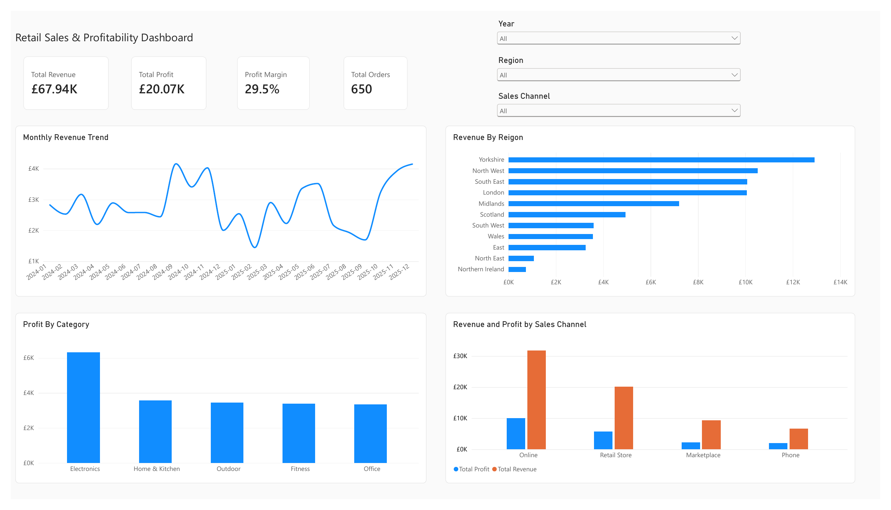
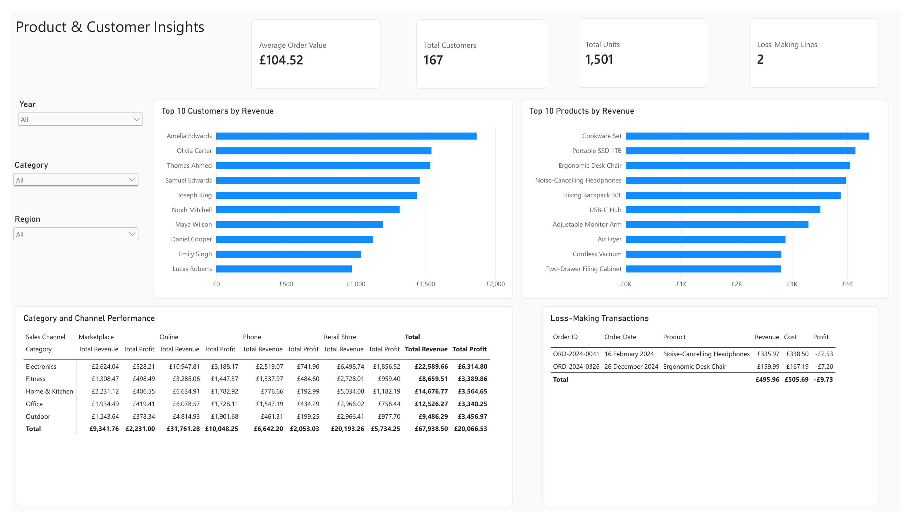

# Retail Sales & Profitability Analysis

An end-to-end data analytics portfolio project using **Excel, MySQL and Power BI** to examine retail performance, profitability, customer value and loss-making transactions.

## Dashboard Preview





## Project Objectives

- Measure revenue, profit, margin, orders and average order value.
- Identify the strongest regions, categories, products, customers and sales channels.
- Analyse monthly performance across 2024 and 2025.
- Detect loss-making transaction lines that require investigation.
- Build an interactive Power BI dashboard connected to a MySQL database.

## Dataset

The project contains **900 transaction lines** representing **650 orders** from **1 January 2024 to 31 December 2025**.

The data includes order dates, customers, locations, products, categories, quantities, prices, revenue, cost, profit, payment methods and sales channels.

## Tools and Workflow

### Excel

- Cleaned and structured the source data as an Excel table.
- Used `SUM`, `SUMIF`, `COUNTIF`, averages, minimums and maximums.
- Built PivotTables for regional, category, product, customer, channel and payment analysis.
- Created an executive dashboard with KPI cards, charts and recommendations.

### MySQL

- Created a relational table with appropriate numeric, date and text data types.
- Imported and validated all 900 transaction lines.
- Wrote 15 analysis queries covering aggregations, grouping, CTEs, ranking and window functions.
- Analysed monthly trends, regional performance, product margins, customer value and year-over-year growth.

### Power BI

- Connected Power BI Desktop to the MySQL database using Import mode.
- Created a dedicated Calendar table and a one-to-many date relationship.
- Built reusable DAX measures for revenue, profit, margin, orders, units, customers and average order value.
- Designed two interactive report pages with Year, Region, Category and Sales Channel slicers.

## Core KPIs

| KPI | Result |
|---|---:|
| Total Revenue | £67,938.50 |
| Total Profit | £20,066.53 |
| Profit Margin | 29.5% |
| Total Orders | 650 |
| Average Order Value | £104.52 |
| Units Sold | 1,501 |
| Customers | 167 |

## Key Findings

- **Yorkshire** generated the highest regional revenue at **£12,909.85**.
- **Electronics** was the most profitable category, producing **£6,314.80** in profit.
- **Online** was the leading sales channel with **£31,761.28** revenue and **£10,048.25** profit.
- **Cookware Set** was the highest-revenue product at **£4,397.72**.
- **Amelia Edwards** was the highest-value customer at **£1,865.60** revenue.
- Only **two transaction lines** were loss-making, with a combined loss of **£9.73** and a worst individual loss of **£7.20**.

## Data Model

The Power BI model uses a simple star-style structure:

```text
Calendar[Date]  1 ──── *  Retail Sales[order_date]
```

The Calendar table controls time-based filtering and ensures the monthly revenue trend is displayed chronologically.

## Repository Files

- [`excel/Portfolio_Project_2_Retail_Sales.xlsx`](excel/Portfolio_Project_2_Retail_Sales.xlsx) - Excel analysis and dashboard.
- [`mysql/01_create_retail_sales_database.sql`](mysql/01_create_retail_sales_database.sql) - database and table creation.
- [`mysql/02_retail_sales_analysis.sql`](mysql/02_retail_sales_analysis.sql) - 15 portfolio analysis queries.
- [`mysql/retail_sales_mysql_ready.csv`](mysql/retail_sales_mysql_ready.csv) - clean MySQL import file.
- [`power-bi/Retail_Sales_Profitability_Dashboard.pbix`](power-bi/Retail_Sales_Profitability_Dashboard.pbix) - interactive Power BI report.
- [`power-bi/Retail_Sales_Profitability_Dashboard.pdf`](power-bi/Retail_Sales_Profitability_Dashboard.pdf) - two-page dashboard export.

## Skills Demonstrated

- Data cleaning and validation
- Excel formulas, PivotTables and dashboard design
- SQL aggregation, CTEs and window functions
- Relational database creation and CSV import
- Power Query, data modelling and DAX
- Interactive dashboard design and business insight communication

## Business Recommendations

1. Prioritise Online sales and Electronics inventory because they produce the strongest revenue and profit contribution.
2. Investigate the two loss-making transactions for discounting, supplier-cost or channel-fee issues.
3. Use the strongest products and high-value customer patterns to guide targeted promotions.
