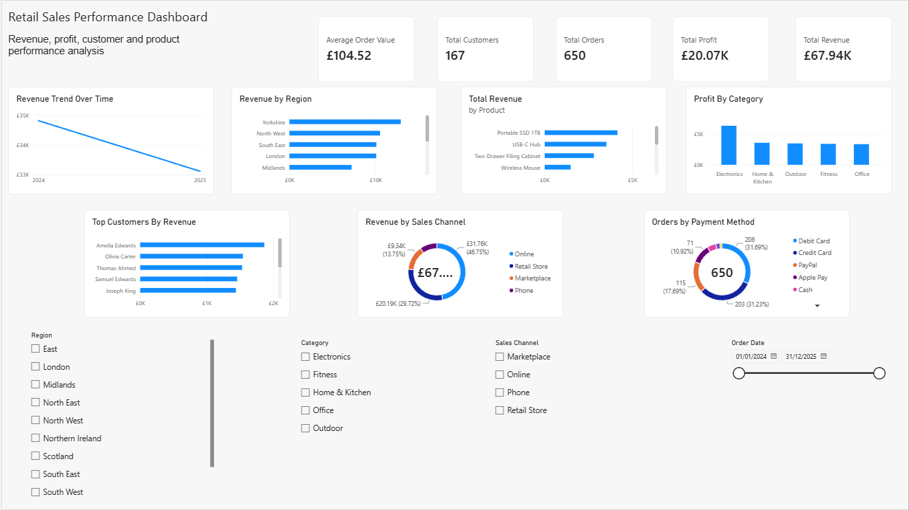
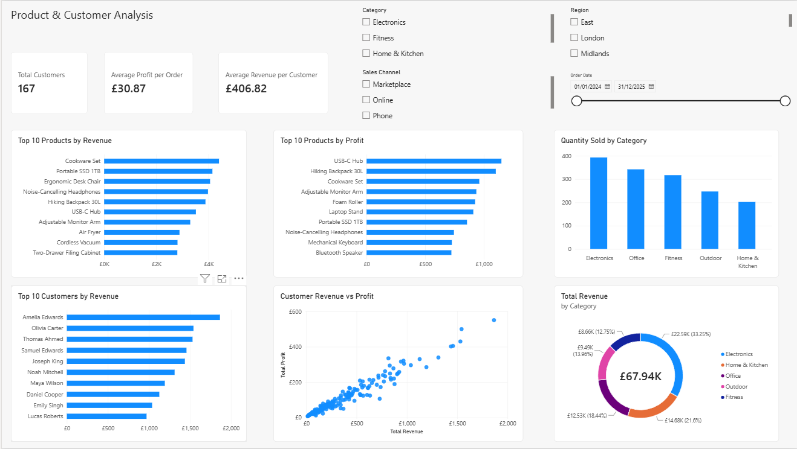
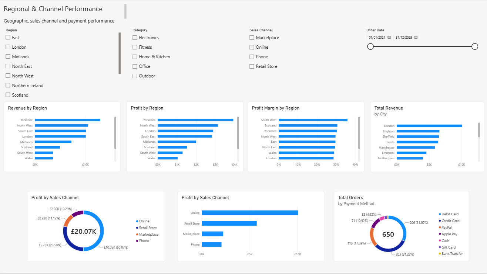

# Retail Sales & Profitability Analysis — Power BI

## Project Overview

This project analyses retail sales performance using **Power BI**, with a focus on revenue, profitability, customer value, product performance, regional performance and sales channels.

The dashboard was built from the cleaned retail sales dataset developed in the wider Retail Sales & Profitability Analysis project. It provides an interactive three-page report designed to answer practical business questions and demonstrate entry-level Data Analyst and Business Intelligence skills.

## Tools Used

- Power BI Desktop
- Power Query
- DAX
- Excel
- SQL / MySQL

## Dashboard Pages

### 1. Executive Overview
A high-level summary of business performance.

Key KPIs:
- Total Revenue: **£67.94K**
- Total Profit: **£20.07K**
- Total Orders: **650**
- Total Customers: **167**
- Average Order Value: **£104.52**

Key visuals:
- Revenue trend over time
- Revenue by region
- Product revenue
- Profit by category
- Top customers by revenue
- Revenue by sales channel
- Orders by payment method



### 2. Product & Customer Analysis
Product, customer and category performance analysis.

Key KPIs:
- Total Customers: **167**
- Average Profit per Order: **£30.87**
- Average Revenue per Customer: **£406.82**

Key visuals:
- Top 10 products by revenue
- Top 10 products by profit
- Quantity sold by category
- Top 10 customers by revenue
- Customer revenue vs profit
- Revenue by category



### 3. Regional & Channel Performance
Geographic, sales channel and payment performance analysis.

Key visuals:
- Revenue by region
- Profit by region
- Profit margin by region
- Revenue by city
- Profit by sales channel
- Orders by payment method



## Key Findings

- **Electronics** generated the highest category revenue and profit.
- **Yorkshire** was the strongest region for both revenue and profit.
- **London** generated the highest city-level revenue.
- **Online** was the strongest sales channel.
- **Cookware Set** ranked highest among products by revenue.
- **USB-C Hub** ranked highest among products by profit.
- **Amelia Edwards** was the highest-value customer by revenue.
- Customer revenue and profit showed a strong positive relationship.
- Debit and credit cards were the two most frequently used payment methods.

## Business Questions

1. How much revenue and profit is the business generating?
2. Which regions and cities perform best?
3. Which products and categories generate the most revenue and profit?
4. Which customers contribute the most value?
5. Which sales channels are most effective?
6. How do revenue and profit relate at customer level?
7. Which payment methods are most commonly used?

## Skills Demonstrated

- Power BI dashboard development
- Power Query data preparation
- DAX measures
- KPI reporting
- Data visualisation
- Top N analysis
- Interactive slicers and filtering
- Product analysis
- Customer analysis
- Regional analysis
- Sales channel analysis
- Business insight communication

## Repository Structure

```text
Retail-Sales-Profitability-Analysis/
├── README.md
├── PowerBI/
│   └── Retail_Sales_PowerBI_Dashboard.pbix
├── Screenshots/
│   ├── 01_Executive_Overview.png
│   ├── 02_Product_and_Customer_Analysis.png
│   └── 03_Regional_and_Channel_Performance.png
└── Documentation/
    └── DAX_Measures.md
```

> GitHub does not preview `.pbix` files directly, so dashboard screenshots are included so recruiters can review the work immediately.
